# Coza Store: Laravel Fashion E-commerce

A fashion and clothing store built with **Laravel 11**. It features a variant-based product catalog, multi-warehouse inventory reservation, a layered discount system, an admin panel with role-based access, and a documented REST API.

<p align="left">
  <!-- Core Stack -->
  
  
  

  <!-- Security & API -->
  
  
</p>

**Contents:**
[Features](#features) ·
[Screenshots](#screenshots) ·
[Tech Stack](#tech-stack) ·
[Architecture](#architecture) ·
[Checkout and Inventory Flow](#checkout-and-inventory-flow) ·
[Getting Started](#getting-started) ·
[Demo Accounts](#demo-accounts)

---

## Features

- **Variant-based catalog:** products with color and size variants, per-variant price and stock, attributes, brands and categories.
- **Server-side shop filtering:** search, category, brand, color, size, price range, stock, discount, tags and sorting.
- **Multi-warehouse inventory:** a variant can be fulfilled from several warehouses, and every reserved unit is traceable to its warehouse. [Details](#checkout-and-inventory-flow)
- **Reservation model:** stock is reserved when an item enters the cart and released automatically when the cart or payment expires.
- **Layered discounts:** amazing sale(time-limited per-variant discount), then store-wide discount, then coupon, followed by shipping cost.
- **Safe checkout:** atomic order creation, pessimistic locking, deadlock retries and an idempotent ZarinPal callback.
- **Admin panel:** dashboard, products and variants, warehouses and stock, orders, payments, deliveries, discounts, content (posts, FAQ, banners, categories, comments, ...), access levels, tickets, email/SMS notifications and settings.
- **Role-based access control:** roles with fine-grained permissions (view, create, update and delete per resource) plus policies.
- **Authentication:** SMS OTP login, with Laravel Sanctum for API tokens.
- **Documented REST API:** Swagger (OpenAPI) docs for auth, products, cart, payment and likes.
- **Background processing:** scheduled commands and queued jobs for cleanup and notifications.
- **Query efficiency:** eager loading throughout the app to avoid N+1 queries.

---

## Screenshots

A quick look at the project. Click an image to enlarge it. All screenshots were taken in a local development environment with seeded demo data.

<table>
  <tr>
    <td width="33%">
      <a href="docs/screenshots/shopping-cart.png">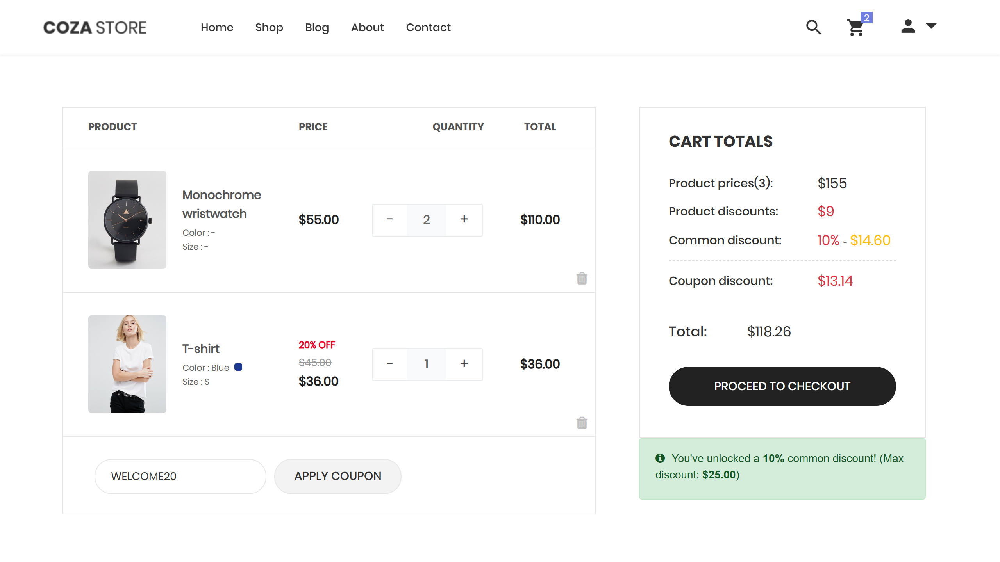</a>
      <br><sub><b>Cart.</b> Layered discounts: amazing sale, store-wide discount and coupon.</sub>
    </td>
    <td width="33%">
      <a href="docs/screenshots/warehouse-variants.png">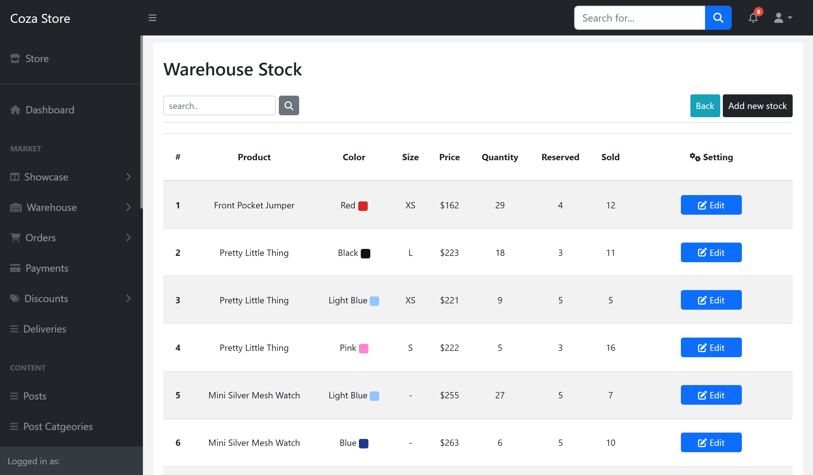</a>
      <br><sub><b>Inventory.</b> Quantity, reserved and sold units per variant and warehouse.</sub>
    </td>
    <td width="34%">
      <a href="docs/screenshots/admin-dashboard.png">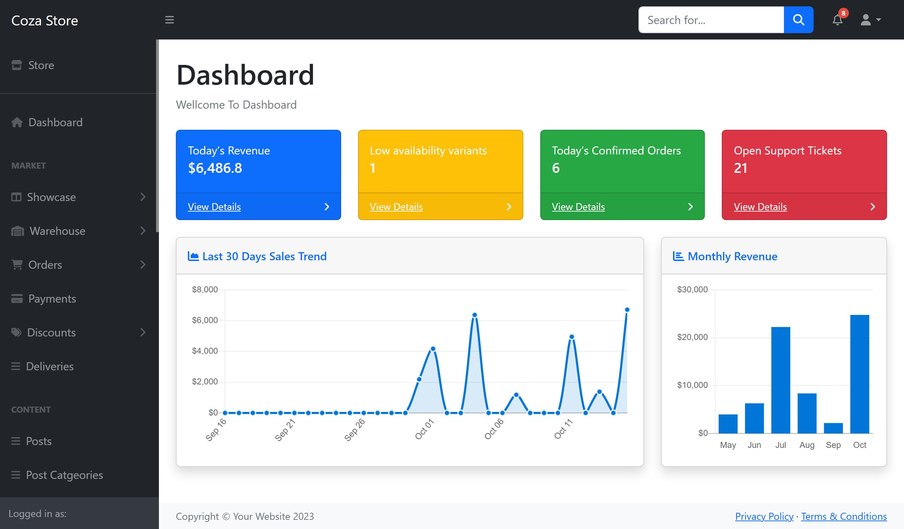</a>
      <br><sub><b>Dashboard.</b> Revenue, low stock, orders, tickets and sales charts.</sub>
    </td>
  </tr>
</table>

<details>
<summary><b>More screenshots</b> (storefront, admin panel and API docs)</summary>

### Storefront

<table>
  <tr>
    <td width="50%">
      <a href="docs/screenshots/shop.png">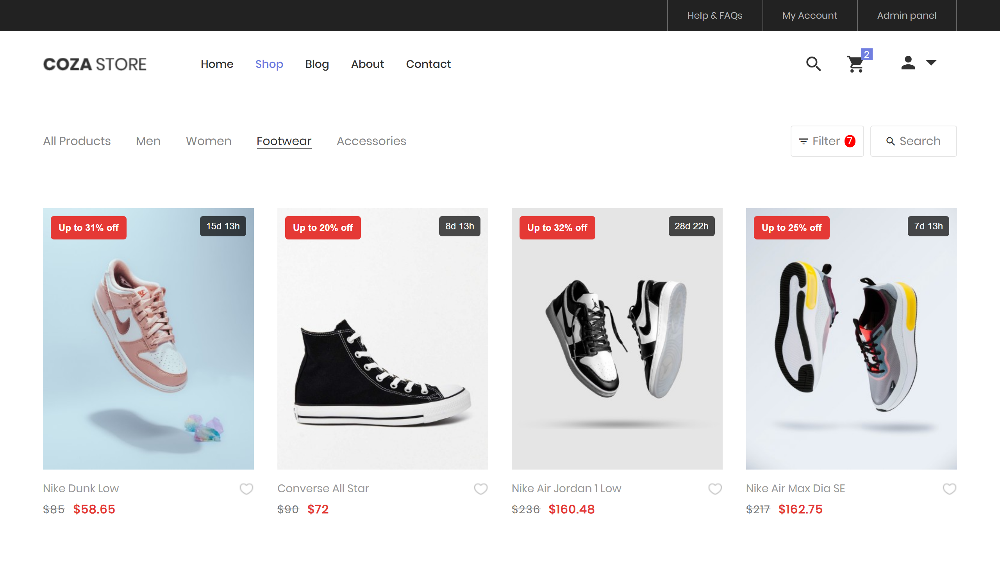</a>
      <br><sub><b>Shop.</b> Category tabs, search, and sale badges with countdown timers.</sub>
    </td>
    <td width="50%">
      <a href="docs/screenshots/shop-filtering.png">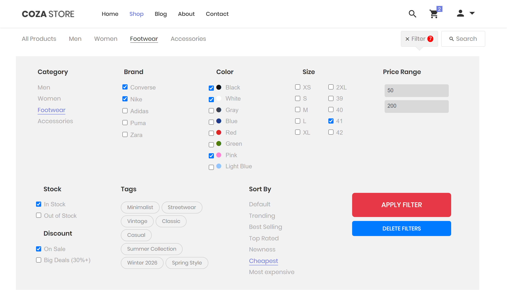</a>
      <br><sub><b>Filtering.</b> Category, search, brand, color, size, price range, stock, discount, tags and sorting, all handled on the back end.</sub>
    </td>
  </tr>
  <tr>
    <td width="50%">
      <a href="docs/screenshots/product-detail.png">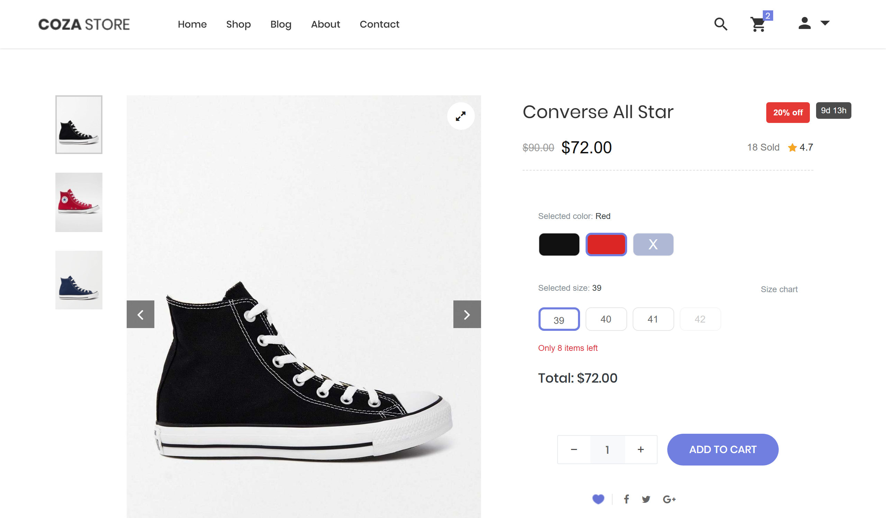</a>
      <br><sub><b>Product detail.</b> Color and size variants, unavailable variants, low-stock warning and sale price.</sub>
    </td>
    <td width="50%">
      <a href="docs/screenshots/home.png">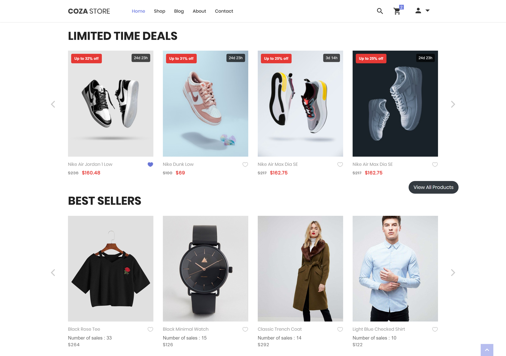</a>
     <br><sub><b>Home.</b> Limited time deals and best sellers sliders with sale badges and countdown timers.</sub>
    </td>
  </tr>
</table>

### Admin panel

<table>
  <tr>
    <td width="50%">
      <a href="docs/screenshots/order.png">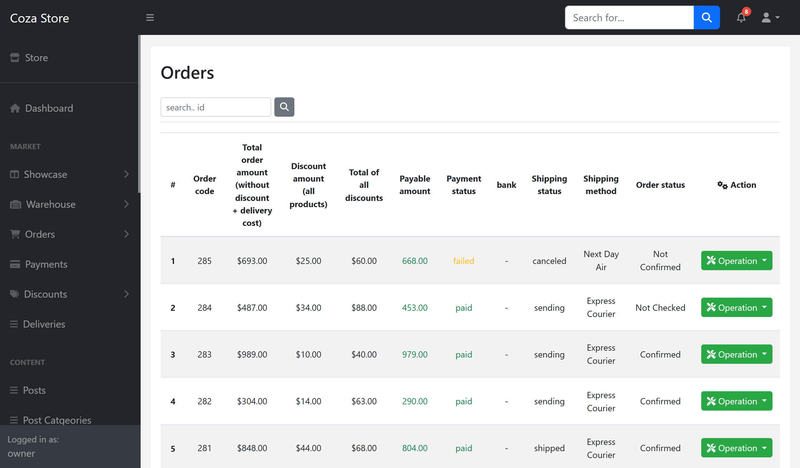</a>
      <br><sub><b>Orders.</b> Payment status, gateway, shipping status and method, discounts and payable amount.</sub>
    </td>
    <td width="50%">
      <a href="docs/screenshots/admin-list.png">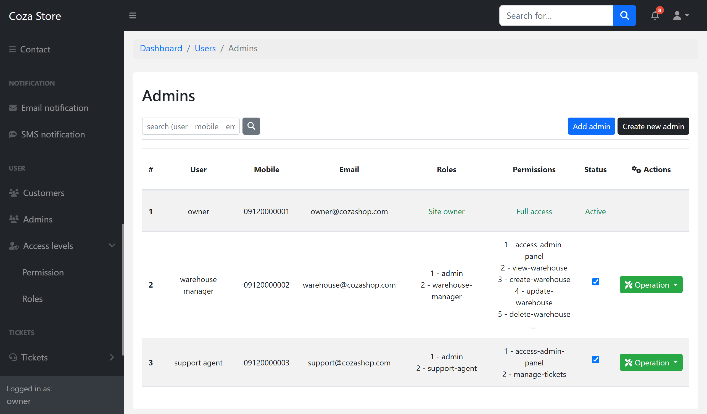</a>
      <br><sub><b>Admins.</b> Role-based access control with per-resource permissions.</sub>
    </td>
  </tr>
</table>

### API documentation (Swagger)

<table>
  <tr>
    <td width="50%">
      <a href="docs/screenshots/swagger1.png">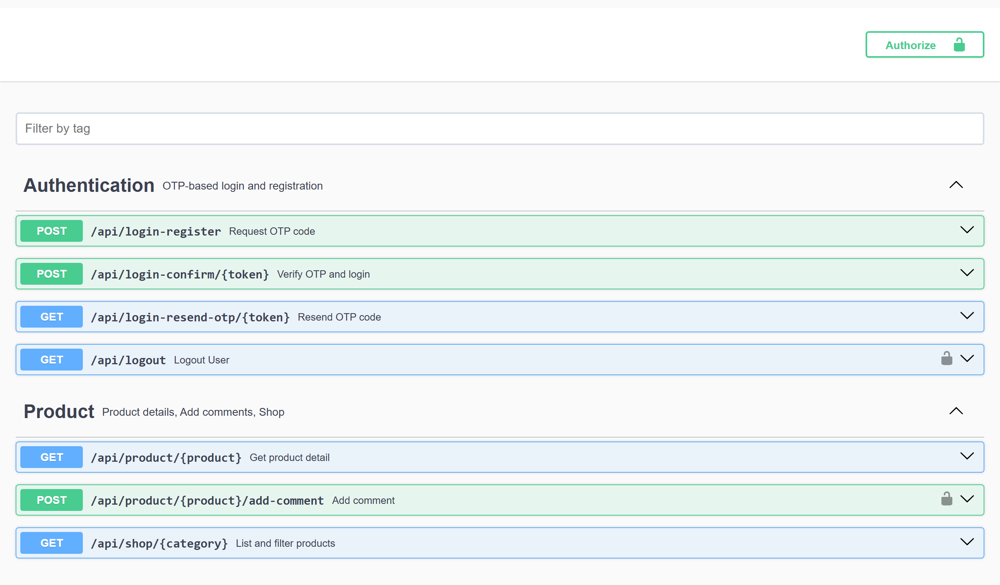</a>
      <br><sub><b>Auth and products.</b> OTP login and registration, product details, comments, shop listing.</sub>
    </td>
    <td width="50%">
      <a href="docs/screenshots/swagger2.png">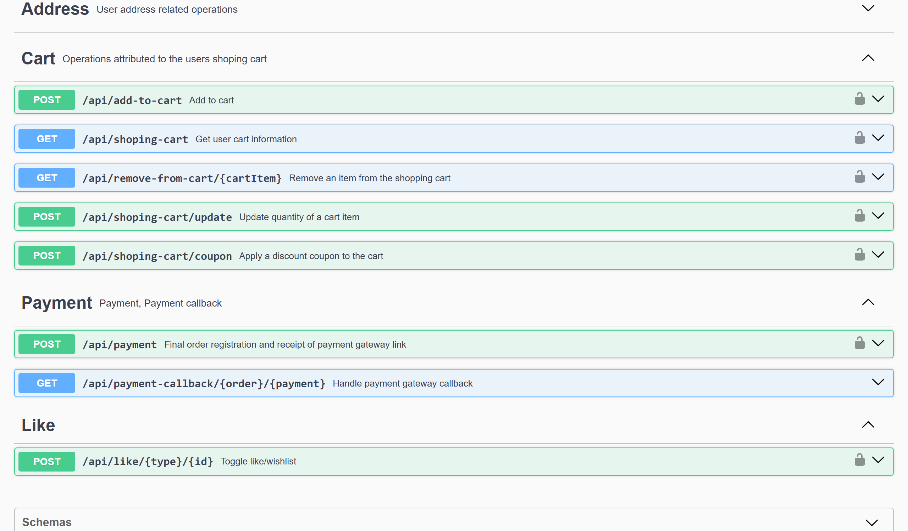</a>
      <br><sub><b>Cart and payment.</b> Cart operations, coupon, payment and payment callback.</sub>
    </td>
  </tr>
</table>

</details>

---

## Tech Stack

| Area      | Technology                                   |
| --------- | -------------------------------------------- |
| Backend   | PHP 8.2+, Laravel 11                         |
| Database  | MySQL / MariaDB                              |
| Auth      | Laravel Sanctum, SMS OTP login (Melipayamak) |
| Payments  | ZarinPal via `shetabit/multipay`             |
| Queue     | Laravel queues (`database` driver)           |
| API docs  | L5-Swagger (OpenAPI)                         |
| Images    | Intervention Image                           |
| Dev tools | Laravel Telescope                            |

> About 90% of the front-end comes from a free template. The custom front-end work is limited to a few interactive parts: the live variant selector on the product page (price, total and availability update when the color or size changes) and the live cart (quantity changes and coupon codes update the totals without a page reload). The main focus is the back end: inventory and stock reservation, orders and payments, layered pricing and discounts, server-side filtering, notifications, and an admin panel with role-based access.

---

## Architecture

Logic shared by the web and API controllers lives in service classes. Web-only features, such as parts of the admin panel, still keep their logic in controllers and could be refactored the same way.

<details>
<summary><b>Project structure</b></summary>

```text
laravel-fashion-store/
├── app/
│   ├── Console/Commands/
│   │   ├── AbandonedOrderCommand.php
│   │   ├── ClearExpiredCartsCommand.php
│   │   ├── ExpireDiscountsCommand.php
│   │   ├── SendScheduledEmailNotifications.php
│   │   └── SendScheduledSMS.php
│   ├── Exceptions/
│   │   ├── CartException.php
│   │   ├── CouponException.php
│   │   └── EmptyCartException.php
│   ├── Http/
│   │   ├── Controllers/
│   │   │   ├── Admin/            # Content, Market, Notification, Setting, Ticket, User
│   │   │   ├── Api/
│   │   │   │   ├── Auth/
│   │   │   │   └── Customer/     # Market, Profile, SalesProcess
│   │   │   ├── Auth/
│   │   │   └── Customer/         # Content, Market, Profile, SalesProcess
│   │   ├── Interfaces/
│   │   │   └── MessageInterface.php
│   │   ├── Middleware/
│   │   ├── Requests/             # FormRequests grouped by Admin / Api / Customer
│   │   └── Resources/            # API Resources
│   ├── Jobs/
│   │   ├── SendEmailToSingleUser.php
│   │   ├── SendEmailToUsers.php
│   │   ├── SendSmsToSingleUser.php
│   │   └── SendSmsToUsers.php
│   ├── Models/                   # Grouped by domain: Content, Market, Ticket, User, ...
│   ├── Notifications/            # LowStock, NewOrderRegistered, PaymentFailed, NewTicket, ...
│   ├── Policies/                 # Address, Cart, Order, Ticket
│   ├── Providers/
│   ├── Services/
│   │   ├── Infrastructure/
│   │   │   ├── File/             # FileService, FileToolService
│   │   │   ├── Image/            # ImageService, ImageToolService
│   │   │   ├── Message/          # MessageService + Email / SMS drivers
│   │   │   └── Payment/          # PaymentService
│   │   ├── AddressService.php
│   │   ├── AuthenticationService.php
│   │   ├── CartCalculator.php
│   │   ├── CartInventoryAllocator.php
│   │   ├── CartService.php
│   │   ├── PaymentCalculationService.php
│   │   ├── ProductFileService.php
│   │   └── ProductService.php
│   └── View/
├── resources/
├── routes/
│   ├── api.php
│   ├── auth.php
│   ├── console.php
│   └── web.php
├── bootstrap/
├── config/
└── database/
```

</details>

---

## Checkout and Inventory Flow

This is the core of the project: how stock is reserved, priced, paid for and released, and how consistency is kept under concurrent requests.

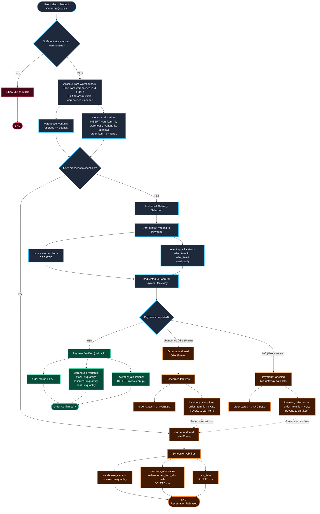

### Data model

| Table                    | Responsibility                                                                                           |
| ------------------------ | -------------------------------------------------------------------------------------------------------- |
| `warehouse_variants`     | Stock of a variant in a specific warehouse: `stock`, `reserved`, `sold`                                  |
| `inventory_allocations`  | Ledger of reserved units: `cart_item_id`, `order_item_id` (nullable), `warehouse_variant_id`, `quantity` |
| `cart_items`             | Cart lines with an `expires_at` (30 minutes, renewed on every change)                                    |
| `orders`, `order_items`  | Orders, with snapshots of prices, discounts, address and delivery method                                 |
| `payments`               | Payment attempts and gateway responses                                                                   |
| `warehouse_transactions` | Stock-out records written when a payment is confirmed                                                    |

**Stock accounting.** Available stock is `stock - reserved`. State transitions:

| Event                                                           | `stock` | `reserved`                              | `sold` |
| --------------------------------------------------------------- | ------- | --------------------------------------- | ------ |
| Add to cart / change quantity                                   |         | `+qty` (old reservation released first) |        |
| Cart expires / item removed / payment canceled and cart expires |         | `-qty`                                  |        |
| Payment confirmed                                               | `-qty`  | `-qty`                                  | `+qty` |

**The `order_item_id` field is the state switch of an allocation row.**
`order_item_id = NULL` means the units are reserved for a cart item. A non-null value means they belong to an order that is in checkout. This lets the same row move between "cart" and "order" states without copying data, and it lets the cleanup job tell apart reservations it may release from reservations that are being paid for.

### 1. Add to cart and reserve

In one transaction the service locks the product variant, rejects the request if the item is already in checkout, and then calls an allocator. The allocator:

1. locks all `warehouse_variants` of the variant, ordered by `id`,
2. releases the item's previous reservation (if any),
3. walks the warehouses in id order and takes `min(remaining, available)` from each until the requested quantity is met,
4. writes one `inventory_allocations` row per warehouse, and throws if stock is insufficient.

The stock check runs after the locks are acquired and is the authoritative one. Earlier checks only give quick feedback.

### 2. Cart and pricing

Totals are calculated by a dedicated calculator in this order:

1. **Amazing sale** (per-variant percentage discount) is applied to the unit price.
2. **Store-wide discount** is applied if the discounted subtotal passes the admin-defined minimum. It can be a percentage or a fixed amount, with an optional ceiling.
3. **Coupon**, one use per user, percentage or fixed, public or tied to a single user.
4. **Shipping cost** is added after the delivery method is chosen.

Cart items that are in checkout cannot be updated or removed.

### 3. Checkout (single transaction, `attempts: 3`)

1. Lock the user's cart items (`orderBy('id')`) and compute totals.
2. If the user has an unpaid, abandoned order, **reuse it**: its allocations go back to `order_item_id = NULL`, its items are deleted and the order is updated with the new data. Otherwise a new order is created.
3. Create the order items and write snapshots (product, amazing sale, address, delivery, coupon, store-wide discount) so later catalog or pricing changes never alter past orders.
4. Lock each cart item's unassigned allocations (`orderBy('id')`, `lockForUpdate`) and set `order_item_id`.
5. Create or update the payment record and redirect to ZarinPal.

### 4. Payment outcomes

| Outcome                 | What happens                                                                                                                                                                                                                                                                       |
| ----------------------- | ---------------------------------------------------------------------------------------------------------------------------------------------------------------------------------------------------------------------------------------------------------------------------------- |
| **Success**             | Verify with the gateway, then in one transaction: mark payment and order as paid, move `stock`/`reserved`/`sold`, write `warehouse_transactions` rows, delete the allocations and cart items, record the coupon use, commit, and then notify admins (including a low-stock alert). |
| **User cancels**        | Order becomes `canceled` and allocations go back to `order_item_id = NULL`. The cart cleanup job releases the reservation when the cart expires.                                                                                                                                   |
| **Abandoned**           | After 15 minutes the scheduled job cancels the order and reverts the allocations, exactly like a user cancel.                                                                                                                                                                      |
| **Verification failed** | Payment is marked `failed`, the order returns to `awaiting_confirmation`, and admins are notified.                                                                                                                                                                                 |
| **Late payment**        | If the order was already canceled (reservations released) and the user pays anyway, the payment is recorded but the order is **not** confirmed, because stock is no longer guaranteed. It needs manual review or a refund.                                                         |

### Concurrency and consistency

- **Pessimistic locking.** Every stock change runs inside a transaction and uses `lockForUpdate()` on the rows involved.
- **Consistent lock ordering.** Rows within a table are always locked in ascending `id` order, and every flow starts from the cart item (add, update, remove, checkout, payment callback, cleanup job), which prevents lock cycles between flows.
- **Re-check after locking.** The cleanup job selects allocations with `whereNull('order_item_id')` _inside_ the locking query, so an item that moved into checkout a moment earlier is skipped instead of released.
- **Deadlock retries.** Deadlocks cannot be ruled out completely, so the checkout transaction uses `attempts: 3`. A rolled-back attempt leaves no partial state, so a retry is safe.
- **Idempotent callback.** The callback locks the order and the payment, and returns early if both are already paid.
- **Side effects after commit.** Admin notifications are sent with `DB::afterCommit()`, so a notification failure cannot roll back a successful payment.

### Scheduled jobs

| Command                     | Schedule rule                         | Action                                                                                                                                                    |
| --------------------------- | ------------------------------------- | --------------------------------------------------------------------------------------------------------------------------------------------------------- |
| `carts:clear-expired-carts` | Cart items past `expires_at` (30 min) | For each item, in its own transaction: lock it, lock its unassigned allocations and warehouse rows, decrement `reserved`, delete allocations and the item |
| `orders:abandoned-expired`  | Unpaid orders older than 15 min       | Cancel the order and set `order_item_id = NULL` on its allocations                                                                                        |

The project also contains commands for expiring discounts and for sending scheduled email and SMS notifications (see `app/Console/Commands`).

### Known limitations and ideas

- **Allocation strategy is greedy by warehouse id.** It does not minimize the number of warehouses used or consider distance or shipping cost.
- **Late payments need manual handling.** An automatic refund or an admin review queue would close this gap.
- **Single database as the source of truth.** Consistency relies on row locks, so this design targets a single primary database.

---

## Getting Started

### Requirements

- PHP 8.2 or higher and Composer
- MySQL or MariaDB

### Installation

```bash
git clone https://github.com/aryamorsali/laravel-fashion-store.git
cd laravel-fashion-store

composer install

cp .env.example .env
php artisan key:generate
```

Create an empty MySQL database, then set the connection in `.env`:

```env
DB_CONNECTION=mysql
DB_HOST=127.0.0.1
DB_PORT=3306
DB_DATABASE=cozashop
DB_USERNAME=root
DB_PASSWORD=
```

Run the migrations and seeders:

```bash
php artisan migrate --seed
```

Start the application:

```bash
php artisan serve
```

### Local URLs

| Page        | URL                                     |
| ----------- | --------------------------------------- |
| Storefront  | http://127.0.0.1:8000                   |
| Admin panel | http://127.0.0.1:8000/admin             |
| API base    | http://127.0.0.1:8000/api               |
| Swagger UI  | http://127.0.0.1:8000/api/documentation |

### Background processes

Inventory reservations are released by scheduled commands, and notifications use the queue. Both need a running process, otherwise the system will not clean up after itself.

```bash
# Runs the scheduler: releases expired carts and cancels abandoned orders
php artisan schedule:work

# Processes queued jobs (QUEUE_CONNECTION=database)
php artisan queue:work
```

> **Important:** without the scheduler, stock that was reserved by expired carts and abandoned payments is never released.

To test the cleanup without waiting for the schedule, run the commands manually:

```bash
php artisan carts:clear-expired-carts
php artisan orders:abandoned-expired
```

### Payment gateway (ZarinPal)

Payments go through `shetabit/multipay`. Set your ZarinPal merchant ID in the payment configuration and use the gateway's sandbox mode for testing, so no real money is charged.

### Other optional settings

| Setting                                        | Default | Notes                                                                                                                                                         |
| ---------------------------------------------- | ------- | ------------------------------------------------------------------------------------------------------------------------------------------------------------- |
| `MAIL_MAILER`                                  | `log`   | Set your SMTP details in `.env` to send real emails. With the default `log` mailer, emails are only written to the log, so no SMTP account is needed locally. |
| `SMS_USERNAME`, `SMS_PASSWORD`, `SMS_OTP_FROM` | empty   | Melipayamak credentials, only needed to send real OTP messages.                                                                                               |

---

## Demo Accounts

Test credentials for local use only.

| Role                    | Mobile        | Email                    | OTP Code | Access                                                  |
| :---------------------- | :------------ | :----------------------- | :------- | :------------------------------------------------------ |
| **Owner (Super Admin)** | `09120000001` | `owner@cozashop.com`     | `111111` | Full access (`is_owner = 1`), settings, role management |
| **Warehouse Manager**   | `09120000002` | `warehouse@cozashop.com` | `111111` | Products, stock and inventory only                      |
| **Support Agent**       | `09120000003` | `support@cozashop.com`   | `111111` | Tickets and user inquiries only                         |

> **Warning:** The fixed OTP `111111` is controlled by `DEMO_OTP_ENABLED` in `.env`. Set it to `true` only on your local machine. In production, set `DEMO_OTP_ENABLED=false` or remove it, and never use demo accounts on a public server.

---

## Author

**Arya Morsali**: [github.com/aryamorsali](https://github.com/aryamorsali)
